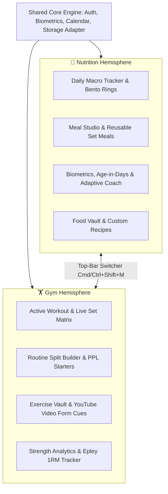
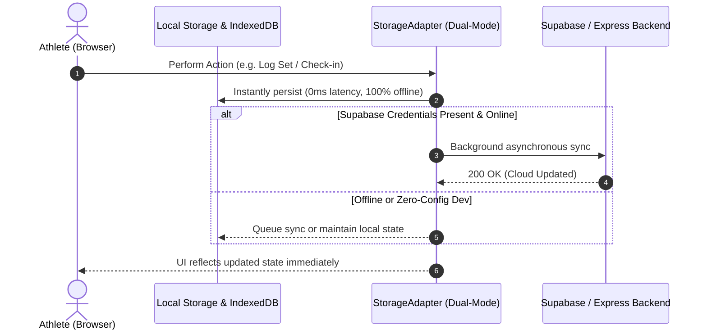
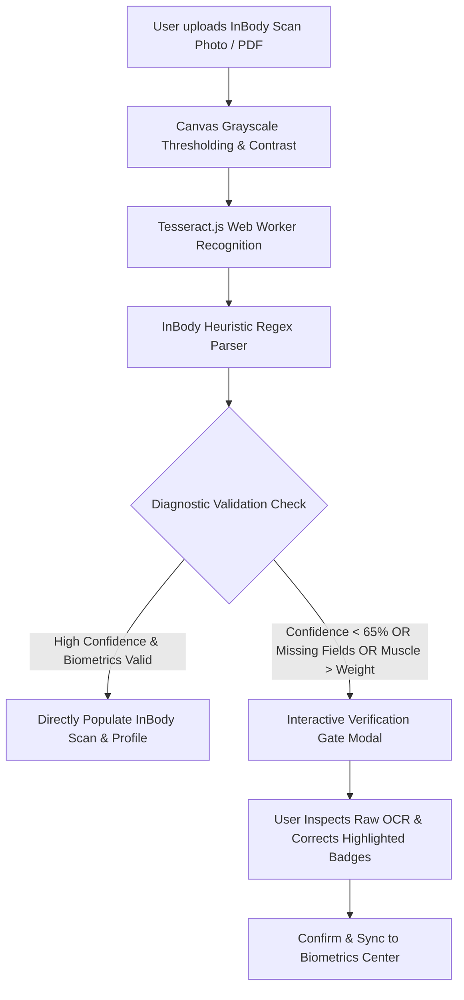

# System Architecture & Engineering Principles

NiuGymFree is engineered around a **Dual-Hemisphere, Local-First, and Cloud-Synchronized** paradigm designed for maximum responsiveness, privacy, and long-term data resilience.

---

## 🧭 The Dual-Hemisphere Paradigm

Traditional fitness software fractures nutrition tracking and strength training into disparate applications or disjointed silos. NiuGymFree unifies them into two distinct operational hemispheres anchored by a shared core:

### Persistent Cross-Hemisphere HUD
When a rest timer or workout is active in the Gym hemisphere and the athlete switches to the Nutrition hemisphere, the **Floating Rest Timer HUD** automatically docks to the bottom-right, allowing continuous rest interval tracking without having to stay on the workout screen.

---

## 🔄 Dual-Tier Storage Architecture

---

## 🔍 InBody OCR Detection & Interactive Verification Gate

