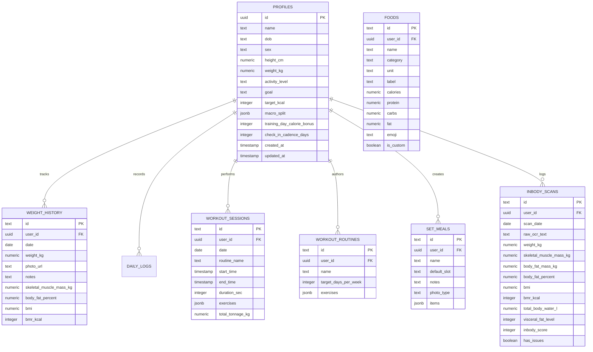

# Database Schema & Data Models

NiuGymFree uses a relational PostgreSQL schema deployed on Supabase with Row Level Security (RLS) enabled on all tables.

---

## 📊 Entity Relationship Diagram



---

## 🔒 Row Level Security (RLS) Policies

All tables enforce tenant isolation where authenticated users can only query or mutate rows where `user_id = auth.uid()`:

```sql
ALTER TABLE profiles ENABLE ROW LEVEL SECURITY;
CREATE POLICY "Users can view and edit own profile"
  ON profiles FOR ALL
  USING (auth.uid() = id);

ALTER TABLE weight_history ENABLE ROW LEVEL SECURITY;
CREATE POLICY "Users can manage own weight entries"
  ON weight_history FOR ALL
  USING (auth.uid() = user_id);

ALTER TABLE foods ENABLE ROW LEVEL SECURITY;
CREATE POLICY "Users can view public foods or manage own custom foods"
  ON foods FOR ALL
  USING (is_custom = false OR auth.uid() = user_id);
```

The idempotent SQL migration script is located at [`backend/supabase/migrations/001_niugymfree_init.sql`](../backend/supabase/migrations/001_niugymfree_init.sql).
